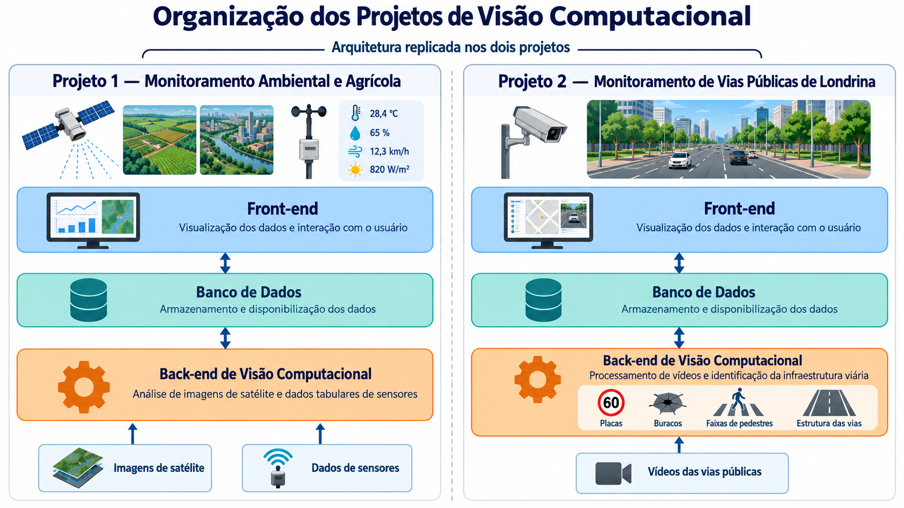

# 🚦 Monitoramento de Vias Públicas de Londrina


Repositório dedicado ao desenvolvimento dos scripts do projeto **Monitoramento de Vias Públicas de Londrina**, cujo objetivo é coletar, processar e analisar dados sobre as condições das vias da cidade, apoiando a identificação de problemas urbanos e a tomada de decisões.

> ⚠️ **Projeto em desenvolvimento.** Os scripts e a documentação podem mudar com frequência.

---

## 📋 Sumário

- [Sobre o projeto](#-sobre-o-projeto)
- [Arquitetura](#️-arquitetura)
- [Objetivos](#-objetivos)
- [Estrutura do repositório](#-estrutura-do-repositório)
- [Tecnologias](#-tecnologias)
- [Como executar](#-como-executar)
- [Equipe](#-equipe)
- [Como contribuir](#-como-contribuir)
- [Licença](#-licença)

---

## 📖 Sobre o projeto

O monitoramento das vias públicas é fundamental para promover a mobilidade urbana, aumentar a segurança no trânsito e melhorar a qualidade de vida da população. Nesse contexto, este projeto tem como objetivo automatizar etapas do processamento e da análise de dados das vias públicas de Londrina – PR, utilizando vídeos como fonte de informação. Por meio de scripts desenvolvidos em Python, os vídeos são divididos em frames (quadros), que são posteriormente analisados para identificar elementos relevantes da infraestrutura urbana, como placas de trânsito, semáforos, buracos e faixas de pedestres.

O projeto é desenvolvido no âmbito da disciplina de Projeto Integrador, da Universidade Tecnológica Federal do Paraná (UTFPR), campus Londrina. A disciplina tem como propósito incentivar os alunos a aplicar os conhecimentos adquiridos ao longo do curso no desenvolvimento colaborativo de soluções tecnológicas para problemas reais. Sob a orientação do professor Danilo, o trabalho busca integrar programação e visão computacional para contribuir com a análise das condições das vias urbanas e fornecer informações que possam auxiliar no planejamento e na gestão da mobilidade urbana.

## 🏗️ Arquitetura

Este repositório corresponde ao **Projeto 2 — Monitoramento de Vias Públicas de Londrina**, que faz parte do Projeto Integrador de Visão Computacional. A arquitetura é replicada nos dois projetos do grupo (o Projeto 1 trata do monitoramento ambiental e agrícola).



No Projeto 2, o fluxo é composto por três camadas:

| Camada | Função |
|--------|--------|
| **Back-end de Visão Computacional** | Processa vídeos das vias públicas e identifica a infraestrutura viária: placas, buracos, faixas de pedestres e estrutura das vias. |
| **Banco de Dados** | Armazena e disponibiliza os dados gerados pelo processamento. |
| **Front-end** | Permite visualizar os dados e interagir com o usuário (mapa, painéis e vídeos). |

A entrada do sistema são os **vídeos das vias públicas**, que passam pelo back-end, são armazenados no banco de dados e ficam disponíveis no front-end.

## 🎯 Objetivos

- Processar vídeos das vias públicas de Londrina com técnicas de visão computacional.
- Detectar e classificar elementos da infraestrutura viária: **placas, buracos, faixas de pedestres e estrutura das vias**.
- Armazenar os resultados em um banco de dados para consulta e análise.
- Disponibilizar um front-end com mapas e painéis para visualização dos dados.
- Documentar o processo para que o projeto possa ser reproduzido e ampliado.

## 📁 Estrutura do repositório

```
├── backend/        # Visão computacional: processamento dos vídeos e detecções
├── frontend/       # Visualização dos dados e interação com o usuário
├── database/       # Scripts e modelagem do banco de dados
├── scripts/        # Scripts auxiliares
├── dados/          # Vídeos e dados brutos/processados
├── docs/           # Documentação, imagens e relatórios
├── notebooks/      # Testes e análises exploratórias
└── README.md       # Descrição do repositório no GitHub
```

## 🛠️ Tecnologias

> Liste aqui o que o grupo realmente utiliza.

- [Python](https://www.python.org/)
- [Git](https://git-scm.com/) e [GitHub](https://github.com/)
- *(ex.: OpenCV, YOLO/PyTorch, banco de dados, flask)*

## 🚀 Como executar

### Pré-requisitos

- Python 3.10 ou superior
- Git

### Instalação

```bash
# Clone o repositório
git clone https://github.com/SEU-USUARIO/NOME-DO-REPOSITORIO.git

# Acesse a pasta do projeto
cd NOME-DO-REPOSITORIO

# (Opcional) Crie e ative um ambiente virtual
python -m venv venv
source venv/bin/activate      # Linux/macOS
venv\Scripts\activate         # Windows

# Instale as dependências
pip install -r requirements.txt
```

### Execução

```bash
python scripts/nome_do_script.py
```

## 👥 Equipe

| Integrante | GitHub |
|------------|--------|
| João Pedro Magri | [@Jpmagri-07](https://github.com/Jpmagri-07) |
| Libina | [@usuario](https://github.com/usuario) |
| Larissa | [@usuario](https://github.com/usuario) |
| Vitória | [@usuario](https://github.com/usuario) |
| Clara | [@usuario](https://github.com/usuario) |
| Ana Clara | [@usuario](https://github.com/usuario) |

## 🤝 Como contribuir

1. Faça um *fork* do projeto ou crie uma *branch* a partir da `main`:
   ```bash
   git checkout -b feature/nome-da-funcionalidade
   ```
2. Faça suas alterações e registre os *commits*:
   ```bash
   git commit -m "Descrição clara da alteração"
   ```
3. Envie para o repositório:
   ```bash
   git push origin feature/nome-da-funcionalidade
   ```
4. Abra um **Pull Request** descrevendo o que foi feito.

**Boas práticas do grupo:**
- Comente o código e use nomes claros para variáveis e funções.
- Não suba dados sensíveis ou arquivos muito grandes.
- Atualize este README quando adicionar novos scripts.

---

<p align="center">Desenvolvido por estudantes para a cidade de Londrina – PR</p>
